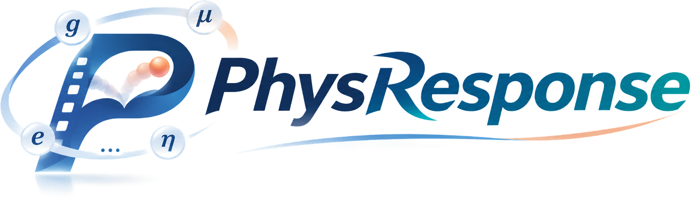
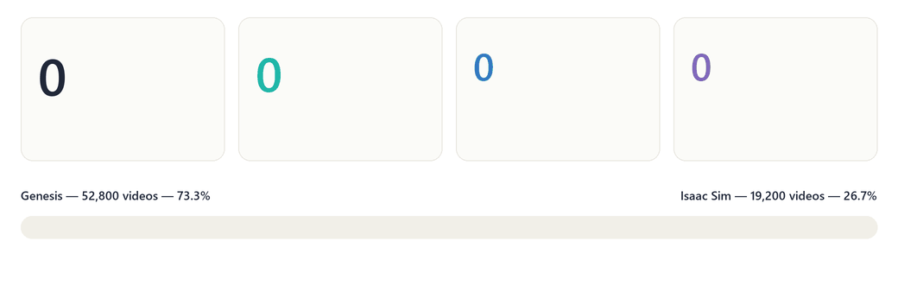
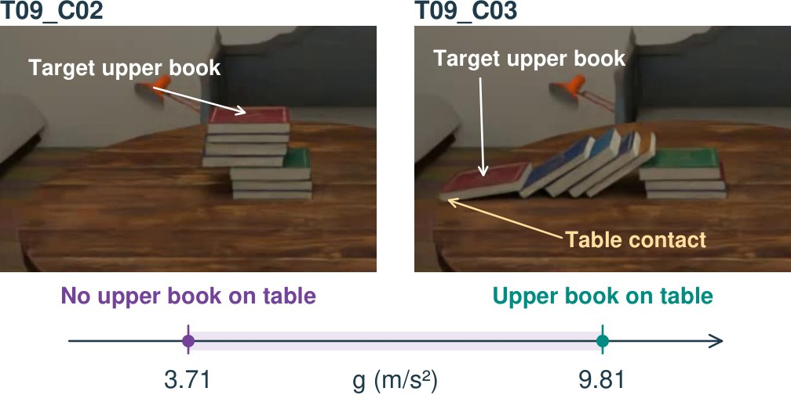
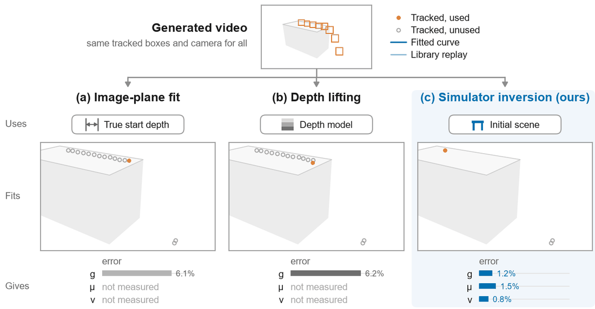

<div align="center">
  
  <h1>Probing the Physics of Video Generation<br>with Controlled Interventions</h1>
  <p><strong><a href="https://aliensco.github.io/PhysResponse-homepage/">Project page</a> &nbsp; · &nbsp; <a href="https://aliensco.github.io/PhysResponse-homepage/#video">Video</a> &nbsp; · &nbsp; <a href="https://arxiv.org/abs/2611.24419">Paper</a> &nbsp; · &nbsp; <a href="https://huggingface.co/datasets/SunYat-senUniversity/PhysResponse">Dataset</a> &nbsp; · &nbsp; <a href="#reproduce-the-pair-scores">Quickstart</a></strong></p>
  <p>
    
    &nbsp;&nbsp;
    
    &nbsp;&nbsp;
    
  </p>
</div>

If we change only gravity, will a book stay on the stack or fall to the table? PhysResponse tests whether a video generator responds to a specified change in gravity, friction, or initial speed. We track the resulting motion to recover effective physical parameters and compare event outcomes across paired interventions.

[](https://aliensco.github.io/PhysResponse-homepage/#video)

## The benchmark

<p align="center"></p>

Core100 evaluates ten base models on 100 cases with four prompt formats (Short, Standard, Detailed, and Concat). The public generation catalog contains 5,200 outputs across base models and fine-tuned variants. Browse the [video and prompt catalog](https://huggingface.co/datasets/SunYat-senUniversity/PhysResponse) or explore [matched examples on the project page](https://aliensco.github.io/PhysResponse-homepage/#qualitative).

## One intervention, two outcomes

<p align="center"></p>

In Core100 cases T09_C02 and T09_C03, the upper book stays supported at **3.71 m/s²** and lands on the table at **9.81 m/s²**. This pair illustrates the two questions behind the benchmark.

- **Parameter inversion.** What value of gravity, friction, or initial speed best explains the tracked motion?
- **Critical-event response.** Does the generated video reproduce the reference event on each side of the transition? NearAcc and FarAcc report class-balanced accuracy using the benchmark’s 20% distance cutoff. PairAcc credits a paired event when both endpoints match their references.

<p align="center"></p>

## Fine-tuning results

On the same 100 cases, both PhysResponse variants reduce the median relative error for all three recovered parameters. The largest reduction for PR-S is in friction, from 130.3% to 70.6%.

| Model | Gravity error ↓ | Friction error ↓ | Initial-speed error ↓ | PSNR ↑ |
|---|---:|---:|---:|---:|
| Wan2.2-TI2V-5B | 94.9% | 130.3% | 85.8% | 23.2 |
| PR-S | **69.1%** | **70.6%** | **45.6%** | **32.1** |
| PR-D | **69.1%** | 87.6% | 67.3% | 32.0 |

See the [full results](https://aliensco.github.io/PhysResponse-homepage/#results) for NearAcc, FarAcc, PairAcc, Coverage, and VPSR under Standard and Detailed prompts.

## Reproduce the pair scores

From the repository root, use Python 3.12 in a virtual environment. The commands below reproduce the published pair scores on CPU from the frozen endpoint judgments.

```sh
python -m pip install . huggingface_hub
hf download SunYat-senUniversity/PhysResponse core100/evaluation/pair_endpoints.jsonl.gz core100/evaluation/expected_pair_scores.csv --repo-type dataset --revision 4ae64ba4b52434715733fe2b43836919b0f023e9 --local-dir evaluation-data
python score_pairs.py --input evaluation-data/core100/evaluation/pair_endpoints.jsonl.gz --expected evaluation-data/core100/evaluation/expected_pair_scores.csv --output scores.csv
```

Expected output: `Verified 120 metric rows`. Each of the 51 registered pairs carries one unit of weight, shared equally across its events. PairAcc divides correct weight by decided weight. Coverage and VPSR divide decided and correct weight, respectively, by 51.

**For parameter inversion**, the GPU pipeline additionally requires the Core100 evaluation base, SAM source, and checkpoint. Download the [Standard evaluation base](https://github.com/aliensco/PhysResponse/releases/tag/evaluation-base-standard-v1) from this repository’s Releases. Consult the [evaluation instructions](docs/EVALUATE.md) and [asset availability](docs/ARTIFACTS.md) for the required inputs.

<details>
<summary>CLI and unit tests</summary>

```sh
physedit --help
python -m physprobe.inversion.evaluate --help
python -m pip install ".[test]"
python -m pytest -q
```

</details>

## Citation and license

```bibtex
@article{li2026physresponse,
  title   = {PhysResponse: Probing the Physics of Video Generation
             with Controlled Interventions},
  author  = {Li, Yuhan and Zhang, Shuran and Tian, Haixin and Rao, Baonuo
             and Li, Weipeng and Hou, Yujia and Wang, Zhenyu and Wang, Zijun
             and Lin, Luoyang and Luo, Lijing and Huang, Jiehui and Yang, Kaiyuan
             and Tan, Jingbin and Hu, Panwen and Liang, Xiaodan},
  journal      = {arXiv preprint arXiv:2611.24419},
  eprint       = {2611.24419},
  archivePrefix = {arXiv},
  url          = {https://arxiv.org/abs/2611.24419},
  year         = {2026}
}
```

The code is available under the [MIT License](LICENSE). Project-owned simulation data, prompts, and annotations use CC BY-NC 4.0. Third-party material follows its applicable terms. See the [dataset license and distribution scope](https://huggingface.co/datasets/SunYat-senUniversity/PhysResponse#access-and-licensing).
